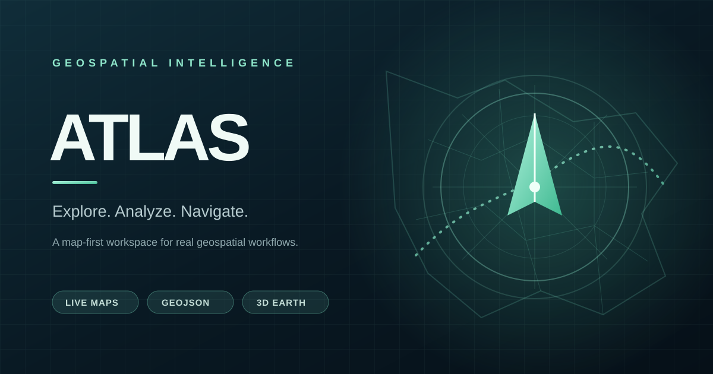

<p align="center"></p>
<h1 align="center">ATLAS 4.3 · Aurora Spatial Workspace</h1>
<p align="center"><strong>Explore. Analyze. Navigate. Operate.</strong><br>A map-first geospatial workspace for real-world exploration and spatial workflows.</p>
<p align="center"><a href="https://tejas-mk2.github.io/ATLAS/"></a> <a href="https://github.com/TEJAS-MK2/ATLAS/actions/workflows/pages.yml"></a> <a href="https://github.com/TEJAS-MK2/ATLAS/actions/workflows/codeql.yml"></a></p>
## Project status
<p>
<a href="https://github.com/TEJAS-MK2/ATLAS/stargazers"></a>
<a href="https://github.com/TEJAS-MK2/ATLAS/network/members"></a>
<a href="https://github.com/TEJAS-MK2/ATLAS/watchers"></a>
<a href="https://github.com/TEJAS-MK2/ATLAS/issues"></a>
<a href="https://github.com/TEJAS-MK2/ATLAS/pulls"></a>
<a href="https://github.com/TEJAS-MK2/ATLAS/graphs/contributors"></a>
<a href="https://github.com/TEJAS-MK2/ATLAS/commits/main"></a>
<a href="https://github.com/TEJAS-MK2/ATLAS"></a>
<a href="https://github.com/TEJAS-MK2/ATLAS"></a>
<a href="https://github.com/TEJAS-MK2/ATLAS"></a>
<a href="https://github.com/TEJAS-MK2/ATLAS/blob/main/LICENSE"></a>
</p>
## Technology & capabilities
<p>


</p>
## ATLAS 4.3 — Aurora Spatial Workspace

The 4.3 refresh introduces a dedicated, versioned Aurora visual layer, tighter desktop workspace proportions, a more legible intelligence inspector, calmer map controls and a more deliberate mobile dock. The previous GIS workflows and DOM hooks are preserved.

The 4.2 refresh delivers a cohesive desktop/mobile command surface, clearer map and inspector hierarchy, improved control ergonomics, and a cache-safe PWA update path. The production build is explicitly versioned so a stale browser shell is easier to detect and recover from.

## ATLAS 3.6 — Field Console refinement

The 3.6 UI release strengthens control hierarchy, focus visibility, touch target sizing, safe-area handling and reduced-motion behaviour while preserving the existing map-first workflows.

## ATLAS 3.5 — Reliability release

The 3.5 release corrects rolling 24-hour activity analytics, hardens persisted monitoring data, escapes stored dashboard labels and strengthens regression and production smoke-test coverage. Existing map, routing, GPS, GeoJSON, workspace and collaboration workflows remain intact.

## ATLAS 3.4 — Field Console

The 3.4 interface refresh sharpens the map-first workspace with a clearer visual hierarchy, refined dark/light surfaces, compact touch navigation, consistent control states, stronger focus treatment and improved small-screen layout. Existing mapping workflows and privacy boundaries are preserved.

## Overview
ATLAS is a responsive, browser-based GIS workspace. The map remains the primary canvas while tools and spatial insights adapt around it. The application uses vanilla JavaScript ES modules and public geospatial providers; their coverage, rate limits and availability are outside ATLAS's control.
## Product capabilities
| Workspace | Capabilities |
|---|---|
| Explore | Interactive map, five basemaps, place search, cursor coordinates and map-center inspection |
| Navigate | Driving routes, nearby points of interest, distance measurement and Street View handoff |
| Analyze | Validated GeoJSON import/export, searchable feature inspector, line length, polygon area, spatial bounds and live feature summaries |
| Organize | Saved places, up to 30 named map views, reusable workspace profiles, configurable dashboard widgets, map sharing and seven-day guest map rooms |
| Field tools | User-initiated device location, opt-in GPS track recording and 3D Earth explorer |
| Platform | Responsive interface, dark/light appearance, customizable workspace profiles and dashboard widgets, layer styling studio, local historical analytics, opt-in geospatial change monitoring, versioned PWA shell with cached local modules and core CDN libraries; map tiles remain network-dependent offline |
| Engineering | Unit tests, Chromium/Firefox/WebKit browser tests, mobile emulation, production smoke checks and CodeQL analysis |
## Interface
ATLAS Aurora uses a restrained spatial-operations visual language: a dominant map canvas, calm navigation, precise controls, clear selected states and a readable intelligence inspector. Layouts adapt across desktop, tablet and narrow mobile viewports. No fabricated live traffic or telemetry is presented.
See [the design system](./docs/DESIGN_SYSTEM.md).
## ATLAS 3.3 capabilities
- **Geospatial change watch:** opt-in, active-tab polling of OpenStreetMap/Overpass within a selected radius; newly observed objects are surfaced as in-session alerts. This is not a guaranteed real-time or emergency feed.
- **Route intelligence:** compare up to three public OSRM driving alternatives by distance and estimated duration.
- **Historical analytics:** locally stored map/route activity summaries and hourly charts.
- **Dashboard personalization:** show/hide intelligence widgets, stored in browser-local preferences.

## ATLAS 3.2 capabilities
- **Spatial analytics:** summarize loaded GeoJSON feature types, line length, polygon area and spatial bounds; filter the active feature set.
- **Layer styling studio:** tune overlay color, line width, fill opacity and line opacity without changing source GeoJSON.
- **Workspace profiles:** save and restore map center, zoom, basemap, appearance and inspector visibility in local browser storage.

These features operate on data already loaded into the browser. No new geolocation permissions or external telemetry are introduced.

## Keyboard shortcuts
- **Ctrl/⌘ + K** — open the command palette
- **/** — focus command search
- **Arrow keys** — move through command results
- **Enter** — run the selected command
- **Escape** — close the command palette
## Quick start
Requirements: Node.js 22+ and Python 3.
```bash
npm ci
npm test
npm run check
npm run test:e2e
python3 -m http.server 8080
```
Open http://localhost:8080.
## Deployment & verification
The GitHub Pages workflow runs unit tests, JavaScript syntax checks and Chromium, Firefox, WebKit and mobile-emulation browser checks before publishing. A post-deployment smoke test checks the live homepage and required assets. CodeQL separately analyzes JavaScript/TypeScript.
- [Deployment workflow](https://github.com/TEJAS-MK2/ATLAS/actions/workflows/pages.yml)
- [CodeQL workflow](https://github.com/TEJAS-MK2/ATLAS/actions/workflows/codeql.yml)
- [ATLAS 4.0 release checklist](./docs/ATLAS_4_RELEASE_CHECKLIST.md)
- [Live application](https://tejas-mk2.github.io/ATLAS/)
## Privacy & service limits
- GPS permission is requested only after a user action.
- Saved places and named map views are stored locally in the browser.
- Shared room data is sent to the configured Supabase backend when a user chooses to create or update a room.
- Search, routing, satellite tiles and OSM feature queries contact their respective external providers.
- Public demo geospatial services can rate-limit requests and do not provide production SLAs.
- Review [Privacy](./docs/PRIVACY.md), [Providers](./docs/PROVIDERS.md) and [Threat model](./docs/THREAT_MODEL.md) before high-volume or sensitive use.
## Project documentation
| Guide | Purpose |
|---|---|
| [Security policy](./SECURITY.md) | Responsible vulnerability reporting |
| [Contributing](./CONTRIBUTING.md) | Development standards and pull requests |
| [Code of Conduct](./CODE_OF_CONDUCT.md) | Community standards |
| [Support](./SUPPORT.md) | Troubleshooting and issue reporting |
| [Changelog](./CHANGELOG.md) | Notable changes |
| [Architecture](./docs/ARCHITECTURE.md) | Runtime components and trust boundaries |
| [Privacy](./docs/PRIVACY.md) | Browser storage, location and sharing |
| [Threat model](./docs/THREAT_MODEL.md) | Assets and security review |
| [Testing](./docs/TESTING.md) | Automated and manual checks |
| [Quality baseline](./docs/QUALITY_BASELINE.md) | Reliability findings and release gates |
| [Providers](./docs/PROVIDERS.md) | External geospatial providers |
| [Design system](./docs/DESIGN_SYSTEM.md) | Visual tokens and responsive rules |
## Contributing
Issues and pull requests are welcome. Read [CONTRIBUTING.md](./CONTRIBUTING.md), run the test suite, and include viewport details for UI bugs.
## License
Released under the [MIT License](./LICENSE).


## ATLAS 4.0 spatial foundation
- **Spatial query primitives:** validate map bounds, compute geometry extents, select features intersecting a bounding box, and test point containment in Polygon/MultiPolygon geometries including polygon holes.
- **Antimeridian-aware bounds:** bounding-box overlap handles extents that cross ±180° longitude.
- **Privacy-first processing:** spatial selection runs locally in the browser; no feature geometry is uploaded by these utilities.


## ATLAS 4.0 — Advanced GIS operations
- **Geometry editor:** select a loaded feature and update a zero-based coordinate vertex with immutable edits; export the edited GeoJSON to preserve it.
- **Geodesic point buffers:** generate a local polygon buffer from a coordinate and radius (1–100,000 metres).
- **Density grids:** calculate a local coordinate-density grid from loaded GeoJSON geometries and render it as a separate analysis overlay.
- Analysis overlays are separate from source layers; clearing them does not delete or modify source features. Operations run in the browser and do not upload geometry.


### Geospatial file interoperability
- Import GeoJSON, KML, GPX and CSV coordinate tables with strict coordinate validation.
- Export active layers as GeoJSON, KML, GPX or CSV.
- ATLAS KML ExtendedData preserves MultiPoint, MultiLineString and MultiPolygon types on ATLAS-to-ATLAS round trips.
- GPX represents paths and polygon boundaries as tracks; CSV is a coordinate-row exchange format and does not preserve geometry topology. Spreadsheet formula prefixes in feature names are neutralized.


## ATLAS 4.0 release hardening
- The PWA precaches its local ES modules and a small allowlist of required CDN libraries. Basemap tiles and live geospatial provider data remain network-dependent.
- KML/GPX imports reject malformed coordinates; XML DTD/entity declarations are not accepted. CSV export neutralizes spreadsheet formula prefixes in feature names.
- Geometry editing, geodesic buffers and density grids handle closed rings and antimeridian-crossing polygons without global-spanning edges.
- The release gate includes Chromium, Firefox, WebKit and mobile-emulation browser checks, plus production asset smoke tests.
